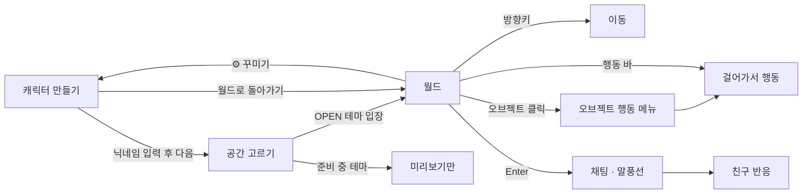

# MOA · 우리의 순간이 모이는 곳

친한 친구들끼리 미니미를 꾸미고, 테마 공간에 모여 채팅하고 함께 노는 프라이빗 2D 소셜 월드.

```bash
pnpm install
pnpm dev         # http://localhost:5173
pnpm build       # tsc(strict) + vite build
```

## 1. 화면 IA

```
MOA
├─ ① 캐릭터 만들기 (create)
│   ├─ 미리보기 스테이지 + 모션 미리보기 (기본/걷기/인사/춤/앉기)
│   ├─ 닉네임
│   ├─ 캐릭터 선택 (프리셋 4 + 랜덤)
│   └─ 커스터마이징 탭: 얼굴 · 헤어 · 옷 · 소품
├─ ② 공간 고르기 (themes)
│   ├─ 테마 카드 8개 (캠핑장 OPEN, 나머지 7개 '준비 중')
│   └─ 상세 패널: 소개 · 할 수 있는 것 · 입장/미리보기
└─ ③ 월드 (world)
    ├─ 상단: 로고 · 공간 이름/접속 인원 · 내 캐릭터 · ⚙ 설정(꾸미기/공간 고르기)
    ├─ 좌측: 공간 이동 · 친구 목록 · 추천 코디
    ├─ 중앙: Phaser 월드 (캐릭터·친구·오브젝트) + 행동 바
    └─ 하단: 채팅 로그 · 감정 표현 · 입력창
```

## 2. 사용자 플로우



## 3. 프로젝트 구조

```
src/
├─ data/                  ← 순수 데이터 (엔진·UI 무관)
│  ├─ character.ts        캐릭터 외형 모델, 옵션, 프리셋
│  ├─ anims.ts            애니메이션 = 포즈 프레임 목록
│  ├─ actions.ts          행동 = 라벨 + 재생할 애니메이션
│  └─ themes.ts           테마 8종 메타 + 플레이 가능한 테마 설정
├─ art/                   ← 픽셀 아트 생성 (에셋 파일 없음)
│  ├─ pix.ts              픽셀 그리드 + 자동 외곽선 + 캔버스 페인트
│  ├─ avatar.ts           (외형, 포즈) → 캐릭터 픽셀
│  ├─ props.ts            모닥불·텐트·그릴·나무 등 오브젝트
│  └─ ground.ts           아이소메트릭 배경
├─ game/                  ← Phaser 전용
│  ├─ iso.ts              타일 ↔ 화면 좌표, 이동 가능 영역
│  ├─ Avatar.ts           스프라이트 + 닉네임 + 말풍선 + 애니메이션 재생
│  └─ WorldScene.ts       ThemeConfig 하나로 어떤 테마든 구성하는 씬
├─ ui/                    ← React 화면 (SCSS Modules)
├─ styles/global.scss     디자인 토큰 (CSS 변수, Phaser도 같은 값을 읽음)
├─ bridge.ts              React ↔ Phaser 타입 지정 채널
├─ store.ts               Zustand (화면, 내 캐릭터, 채팅, 선택 상태)
└─ mock.ts                더미 친구 2명 + 자동 채팅 (실시간 서버 자리)
```

## 4. 핵심 설계

**캐릭터 하나, 렌더러 하나.** `renderAvatar(look, pose)`가 픽셀 그리드를 만들고, 같은 결과를 React `<canvas>`(꾸미기 화면·친구 목록)와 Phaser `CanvasTexture`(월드)에 그립니다. 외형이 바뀌면 둘 다 그대로 따라옵니다.

**행동 ≠ 애니메이션.**

```
ActionId ('roast')  →  ActionDef { anim: 'campfire', durationMs? }   (actions.ts)
AnimKey ('campfire') →  { fps, frames: Pose[] }                       (anims.ts)
Pose                →  픽셀                                           (art/avatar.ts)
```

어디서 행동하는지는 테마가 정합니다. 오브젝트의 `actions`에 들어 있으면 그 오브젝트의 빈 `spots`로 걸어가서 실행하고, 아니면 제자리에서 실행합니다.

**테마 = 데이터.** `ThemeConfig { themeId, name, background, spawnPosition, availableActions, interactionObjects, recommendedOutfits, decorations }`. `WorldScene`에는 테마별 분기가 없습니다. 개발 모드에서는 `checkThemes()`가 스폰/스팟 위치와 행동 참조를 검사합니다.

**React ↔ Phaser는 `bridge.ts`로만 통신합니다.**

| 방향 | 이벤트 | 내용 |
|---|---|---|
| React → Phaser | `act` | 내 캐릭터 행동 실행 |
| | `chat` | 말풍선 표시 |
| | `look` | 외형 변경 반영 |
| Phaser → React | `objectClick` | 오브젝트 행동 메뉴 열기 |
| | `actionChange` | 행동 바 활성 표시 |

## 5. 새 테마 추가하기

1. `anims.ts`에 필요한 애니메이션 추가 (예: `swim`), 필요하면 `art/avatar.ts`에 포즈/소품 추가
2. `actions.ts`에 행동 추가
3. `art/props.ts`에 오브젝트 아트 추가
4. `themes.ts`에 `ThemeConfig` 작성 후 `THEME_CONFIGS`에 등록하면 끝 (UI는 자동으로 OPEN 처리)

## 6. 로드맵

- [x] **MVP**: 캐릭터 꾸미기, 캠핑장, 방향키 이동, 모닥불·앉기·요리 모션, 더미 친구 2명, 로컬 채팅, 테마 선택(7개 미리보기)
- [ ] 나머지 7개 테마 (교회 → 도서관 → 레스토랑 순으로 모션 재사용이 쉬움)
- [ ] 테마 애니메이션: pray, swim, tennis_swing, workout, read, try_on, eat
- [ ] Supabase: 프로필 저장(현재 localStorage), Realtime 채널로 위치·행동·채팅 동기화 (`mock.ts` 교체)
- [ ] 오브젝트 충돌, 뒷모습 프레임, 클릭 이동
