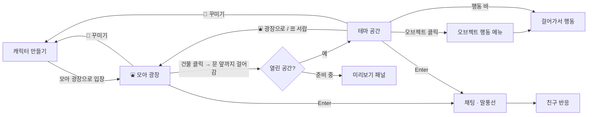

# MOA · 우리의 순간이 모이는 곳

친한 친구들끼리 미니미를 꾸미고, 테마 공간에 모여 채팅하고 함께 노는 프라이빗 3D 소셜 월드.

스택: React 19 + TypeScript · Three.js + React Three Fiber (+ drei) · Zustand · SCSS Modules · Vite

```bash
pnpm install
pnpm dev         # http://localhost:5173
pnpm build       # tsc(strict) + vite build
pnpm check       # 랠리 미니게임 · 길찾기 규칙 검사 (node)
```

### 배포 (Vercel)

**https://moa-moa-beta.vercel.app**

- `main`에 push → 자동으로 프로덕션 배포 (GitHub 연동, 1분 안팎)
- 다른 브랜치 push → 브랜치별 미리보기(Preview) URL 생성. 커밋 옆 Vercel 체크에서 링크 확인
- 빌드 설정은 Vercel이 자동 감지: `pnpm install` → `pnpm build` → `dist/`
- `vercel.json`: 해시가 붙은 `/assets/*`는 1년 캐시(immutable), `index.html`은 매번 새로 받음
- 로컬에서 직접 배포가 필요하면 `npx vercel --prod` (Vercel 로그인 필요)

### 폰에서 앱으로 쓰기 (PWA)

위 주소를 폰에서 열고 홈 화면에 추가하면 주소창 없는 앱으로 실행됩니다.

- **Android · Chrome / Edge(PC 포함)**: 캐릭터 만들기 화면이나 ☰ 서랍의 `📲 앱으로 설치` 버튼 (또는 브라우저 메뉴 → 앱 설치)
- **iPhone · iPad (Safari)**: 공유 버튼 → `홈 화면에 추가` (앱 안에도 안내가 보입니다)
- 한 번 열면 앱 화면·그림·폰트가 캐시돼서 바로 열리고, 오프라인에서도 실행됩니다 (`public/sw.js`)
- 아이콘(`public/icons/`)은 게임 캐릭터 렌더러로 그린 PNG입니다

## 1. 화면 IA

```
MOA
├─ ① 캐릭터 만들기 (create)
│   ├─ 미리보기 스테이지 + 모션 미리보기 (기본/걷기/인사/춤/앉기)
│   ├─ 닉네임
│   ├─ 캐릭터 선택 (프리셋 4 + 랜덤)
│   └─ 커스터마이징 탭: 얼굴 · 헤어 · 옷 · 소품
└─ ② 월드 (world)
    ├─ ⛲ 모아 광장 (첫 입장 장소, 모두가 모이는 허브)
    │   ├─ 테마 건물 8채: 간판 · 테마 색 지붕 (아직 안 만든 테마는 회색 + 🔒 → 미리보기)
    │   └─ 분수 · 벤치 (앉기 · 인사 · 춤)
    ├─ 테마 공간 8곳: 🏕️ 캠핑장 · ⛪ 교회 · 🏊 수영장 · 🎾 테니스장 · 🏋️ 헬스장 · 📚 도서관 · 🛍️ 쇼핑몰 · 🍝 레스토랑
    ├─ 전체 화면: 3D 월드 (원근 쿼터뷰 카메라가 나를 부드럽게 따라감, 맵 밖으로는 안 나감)
    └─ 월드 위에 떠 있는 UI
        ├─ 상단 바: ☰ · 로고 · 공간 이름/접속 인원 · ⛲ 광장으로 · 내 캐릭터(꾸미기)
        ├─ ☰ 서랍: 공간 이동(광장 + 8개) · 친구 목록 · 추천 코디
        ├─ 패널(데스크톱 우측 / 폰 하단 시트): 응원 보드 · 집중 타이머 · 메뉴 · 랠리 미니게임 · 피팅룸 · 미리보기
        └─ 하단 독: 채팅 로그 · 감정 표현 · 입력창 + 행동 바
```

## 2. 사용자 플로우



## 3. 프로젝트 구조

```
src/
├─ data/                  ← 순수 데이터 (엔진·UI 무관)
│  ├─ character.ts        캐릭터 외형 모델, 옵션, 프리셋
│  ├─ anims.ts            애니메이션 = 포즈 프레임 목록
│  ├─ actions.ts          행동 = 라벨 + 재생할 애니메이션
│  └─ themes/             테마 하나당 파일 하나 (camping.ts, church.ts, …)
│     ├─ index.ts          등록부: PLAYABLE, THEMES(광장 건물 순서), THEME_CONFIGS
│     ├─ plaza.ts          테마 목록으로 광장을 만드는 makePlaza
│     └─ seats.ts          가구 뒤 좌석 헬퍼
├─ world/                 ← 3D 월드 (React Three Fiber)
│  ├─ space.ts            타일 ↔ 월드 좌표 (x = tx·T, z = ty·T), 이동 속도, 카메라 방향
│  ├─ sim.ts              월드 규칙: 걷기·길찾기·행동·문·더미 친구 AI (렌더러와 무관한 순수 TS)
│  ├─ path.ts             가구 발판(원) 피해 걷기: 이동 가능 판정 + 길찾기 (순수 함수)
│  ├─ kinds.ts            오브젝트 종류 + 물리 정보(막는 반경 foot, 불빛 light)
│  ├─ models.tsx          종류별 3D 모델 (temp = 아직 블록 대역)
│  ├─ Avatar3D.tsx        3D 캐릭터 (외형 → 메시) + 포즈 → 관절 애니메이션
│  ├─ Stage.tsx           조명·바닥(러그·길·코트 라인)·실내 벽/창·야외 들판/나무/꽃·입자
│  ├─ World.tsx           캔버스 조립: 카메라, 입력(방향키·탭), 오브젝트, 캐릭터, 라벨
│  ├─ labels.ts           닉네임·말풍선·간판을 3D 위치에 맞춰 띄우는 DOM 레이어
│  └─ toon.ts             카툰(셀) 셰이딩 재질 · 캔버스 텍스처
├─ art/                   ← UI 아이콘용 2D 캐릭터 렌더러 (3D 썸네일로 교체 예정)
├─ hooks/                 ← 기능: React 쪽 로직 (구독·이펙트·핸들러)
│  ├─ useWorldSession.ts  게임 이벤트 → 스토어, 더미 친구, 공간 이동 목록
│  ├─ useActionBar.ts     표시할 행동 목록, 실행
│  ├─ useChat.ts          채팅 전송, Enter 포커스, 자동 스크롤
│  └─ useCheerBoard.ts    응원 메모 작성, 보드 닫기
├─ ui/                    ← 화면: 마크업 + className 만 (Panels.tsx = 월드 위 패널들)
├─ styles/                ← 스타일: 보이는 것 전부
│  ├─ global.scss         디자인 토큰 (CSS 변수) + 리셋
│  ├─ *.module.scss       화면별 스타일 (common = 버튼·칩·카드·로고)
│  ├─ World.module.scss   월드 위 라벨: 닉네임·말풍선·간판
│  └─ fonts.ts            픽셀 폰트 등록
├─ bridge.ts              React ↔ 3D 월드 타입 지정 채널
├─ store.ts               Zustand (화면, 내 캐릭터, 채팅, 선택 상태)
└─ mock.ts                더미 친구 2명 + 자동 채팅 (실시간 서버 자리)
```

**기능 / 스타일 분리 규칙**
- `ui/*.tsx`는 마크업과 `className`만 갖습니다. 상태 구독·이펙트·이벤트 로직은 `hooks/`로.
- 색·폰트·여백 같은 값은 `styles/`에만 둡니다. 데이터에서 오는 색(테마 하늘색, 색상 옵션)은 `style={{ '--stage-bg': … }}`처럼 CSS 변수로만 넘기고 실제 적용은 SCSS가 합니다.
- 월드 위 글자(닉네임·말풍선·간판)는 3D가 아니라 DOM이라 `World.module.scss`와 토큰으로 스타일합니다.
- 예외: 3D 모델과 캐릭터의 재질 색(`world/`)은 그림 자체라서 코드에 둡니다.

## 4. 핵심 설계

**3D 월드.** 테마 데이터는 타일 좌표(tx, ty)로 배치하고, 월드는 그 격자를 바닥에 눕힙니다(`x = tx·T`, `z = ty·T`). 카메라는 +x +z 대각선에서 원근 쿼터뷰로 내려다보고, 모든 모델은 기본으로 카메라 쪽을 봅니다. 그래서 2D 시절의 배치·좌석·벽 위치가 그대로 3D에 맞습니다. 규칙(`sim.ts`)은 렌더러를 모르고, 화면(`World.tsx`)은 매 프레임 그 상태를 읽어 그립니다.

**카툰 렌더링.** 모든 재질은 3단계 셀 셰이딩(`toon.ts`), 톤 매핑 없이(`flat`) 파스텔 색 그대로, 해와 하늘빛 + 부드러운 그림자. 밤 테마는 달빛 + 모닥불·랜턴 불빛.

**에셋 등급.** `models.tsx`에서 `temp: true`인 종류는 블록 대역(개발 모드에서 라벨에 `임시` 표시), 나머지는 코드로 만든 스타일라이즈드 모델입니다. 최종 GLB 모델은 같은 로컬 좌표(바닥 y=0, 앞면 +z)로 교체합니다.

**행동 ≠ 애니메이션.**

```
ActionId ('roast')  →  ActionDef { anim: 'campfire', durationMs? }   (actions.ts)
AnimKey ('campfire') →  { fps, frames: Pose[] }                       (anims.ts)
Pose                →  관절 각도 (프레임 사이 보간)                  (world/Avatar3D.tsx)
```

어디서 행동하는지는 테마가 정합니다. 오브젝트의 `actions`에 들어 있으면 그 오브젝트의 빈 `spots`로 걸어가서 실행하고, 아니면 제자리에서 실행합니다. 같은 행동을 주는 오브젝트가 여러 개면(교회 긴 의자 6개) 빈자리가 있는 가장 가까운 것으로 가고, 오브젝트를 클릭해서 고른 경우엔 그 오브젝트로 갑니다. `opens: 'board'` 같은 행동은 실행 중에 React 패널을 엽니다.

**테마 = 데이터.** `ThemeConfig { themeId, name, background, spawnPosition, availableActions, interactionObjects, recommendedOutfits, decorations }`. 월드 코드에는 테마별 분기가 없습니다. 광장도 테마 하나이고, 건물은 `enter: themeId`를 가진 오브젝트입니다(`THEMES` 목록에서 자동 생성). 새 테마를 `PLAYABLE`에 넣으면 광장 건물의 🔒이 자동으로 풀립니다. 개발 모드에서는 `checkThemes()`가 스폰/스팟 위치와 행동 참조를 검사합니다.

**React ↔ 3D 월드는 `bridge.ts`로만 통신합니다.**

| 방향 | 이벤트 | 내용 |
|---|---|---|
| React → 월드 | `act` | 내 캐릭터 행동 실행 (`objectId`로 대상 지정 가능) |
| | `stop` | 행동 중지 (패널 닫기) |
| | `chat` | 말풍선 표시 |
| 월드 → React | `objectClick` | 오브젝트 행동 메뉴 열기 |
| | `actionChange` | 행동 바 활성 표시 |
| | `portal` | 건물 문 앞 도착 → 입장 또는 미리보기 |

## 5. 새 테마 추가하기

1. `anims.ts`에 필요한 애니메이션 추가 (예: `swim`), 새 포즈 값이면 `world/Avatar3D.tsx`의 `targets()`에 관절 각도 추가
2. `actions.ts`에 행동 추가
3. `world/kinds.ts`에 종류 추가 (`foot` = 막는 바닥 반경, 앉거나 올라서는 물건은 생략) + `world/models.tsx`에 3D 모델
4. `data/themes/<테마>.ts`에 `ThemeConfig` 작성 → `index.ts`의 `PLAYABLE`과 `THEMES`에 넣으면 끝 (광장 건물·사이드바가 자동으로 열림)
   - 패널이 필요하면 행동에 `opens`를 달고 `hooks/`에 로직, `ui/Panels.tsx`에 마크업, `styles/Panels.module.scss`에 스타일
   - 배경 옵션: 야외는 `night`(별·달) · `hills` · `flowers`, 실내는 `walls`(스테인드글라스 창) · `rugs`(바닥 러너), 공통으로 `motes`(반딧불·먼지 입자)
5. (선택) `mock.ts`의 `AMBIENT`에 그 공간에서 친구들이 할 말 추가
6. `pnpm dev`로 열면 `checkThemes()`가 시작 위치·행동 자리가 맵 안, 가구 발판 밖인지 검사합니다

## 6. 로드맵

- [x] **MVP**: 캐릭터 꾸미기, 캠핑장, 방향키 이동, 모닥불·앉기·요리 모션, 더미 친구 2명, 로컬 채팅, 테마 선택(7개 미리보기)
- [x] **교회**: 첫 실내 테마. 기도·긴 의자 앉기·촛불 켜기 모션, 응원 보드(메모 저장, 친구 반응)
- [x] **모아 광장**: 첫 입장 허브. 테마 건물 클릭 → 문까지 걸어가 입장, 준비 중 건물은 미리보기 (테마 선택 화면 대체)
- [x] **도서관**: 책 읽기·공부하기 모션, 테이블 뒤에 앉는 좌석, 집중 타이머 패널(5/15/25분)
- [x] **레스토랑**: 식사·음료·대화 모션, 테이블 4개(뒤쪽 좌석), 주문 카운터 + 메뉴 패널(주문하면 잠시 뒤 서빙 알림)
- [x] **헬스장**: 덤벨·러닝·스트레칭(몸 기울이기)·스쿼트 모션, 러닝머신 2대·덤벨 랙·요가 매트, 거울 벽
- [x] **수영장**: 물속 포즈(어깨까지 잠김), 수영·튜브·물장구 모션, 선베드·파라솔·사다리, 낮 하늘
- [x] **테니스장**: 서브·스윙·랠리 모션(라켓), 대각선 네트, 랠리 미니게임(타이밍, 갈수록 빨라짐 · `pnpm check`로 규칙 검사)
- [x] **쇼핑몰**: 옷걸이·피팅룸·전신 거울, 런웨이 러그, 옷 구경·try_on(빙글)·거울 포즈 모션, 피팅룸 패널(코디 6종을 내 캐릭터로 미리보기 → 바로 갈아입기, 코디 공유, 직접 꾸미기)
- [x] **앱(PWA)**: 홈 화면 설치(매니페스트·아이콘), 설치 버튼 / iOS 안내, 서비스 워커로 즉시 실행·오프라인 실행
- [x] **3D 월드 기반**: Phaser 2D → React Three Fiber. 원근 쿼터뷰 추적 카메라(경계 제한), 카툰 셰이딩·그림자, 3D 캐릭터(포즈 데이터 → 관절 보간), 광장 3D 모델(건물·분수·벤치·나무·덤불·화분·바위), 실내 벽·스테인드글라스 창, 야외 들판·나무·꽃, 탭/방향키 이동·충돌·길찾기 유지
- [ ] 테마별 3D 모델 (현재 `temp` 블록 대역) · 손에 드는 소품 · 근접 상호작용 버튼 · 수영장 물
- [ ] 3D 캐릭터 꾸미기 화면 (회전 미리보기, 얼굴형·코) · UI 아이콘 3D 썸네일
- [ ] Supabase: 프로필 저장(현재 localStorage), Realtime 채널로 위치·행동·채팅 동기화 (`mock.ts` 교체)
- [x] **전체 화면 + 모바일**: 월드가 화면을 꽉 채우고 UI는 그 위에 떠 있음. 폰(세로·가로)에선 한 열 레이아웃, 카메라가 나를 따라감, 고해상도(DPR) 렌더링
- [x] **클릭·탭 이동**: 바닥을 누르면 그 자리로 걸어감(맵 밖은 가장자리로), 누른 자리에 링 표시, 터치하면 채팅 키보드 닫힘
- [x] **오브젝트 충돌**: 가구·나무가 바닥을 막음(방향키는 가장자리를 미끄러짐), 클릭·행동·친구 이동은 길찾기로 돌아감, 막힌 곳을 누르면 가장 가까운 곳까지
- [x] **뒷모습**: 화면 위쪽으로 걸으면 뒤통수·뒷머리(긴 머리는 등까지)·후드가 보이고, 멈춰도 유지, 행동을 시작하면 다시 앞모습
