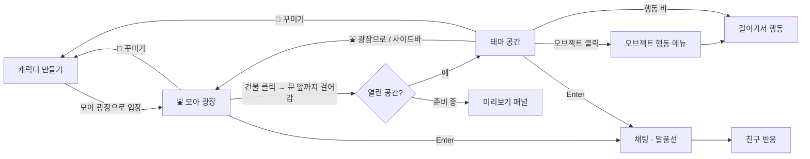

# MOA · 우리의 순간이 모이는 곳

친한 친구들끼리 미니미를 꾸미고, 테마 공간에 모여 채팅하고 함께 노는 프라이빗 2D 소셜 월드.

```bash
pnpm install
pnpm dev         # http://localhost:5173
pnpm build       # tsc(strict) + vite build
pnpm check       # 랠리 미니게임 규칙 검사 (node)
```

### 배포 (Vercel)

**https://moa-moa-beta.vercel.app**

- `main`에 push → 자동으로 프로덕션 배포 (GitHub 연동, 1분 안팎)
- 다른 브랜치 push → 브랜치별 미리보기(Preview) URL 생성. 커밋 옆 Vercel 체크에서 링크 확인
- 빌드 설정은 Vercel이 자동 감지: `pnpm install` → `pnpm build` → `dist/`
- `vercel.json`: 해시가 붙은 `/assets/*`는 1년 캐시(immutable), `index.html`은 매번 새로 받음
- 로컬에서 직접 배포가 필요하면 `npx vercel --prod` (Vercel 로그인 필요)

## 1. 화면 IA

```
MOA
├─ ① 캐릭터 만들기 (create)
│   ├─ 미리보기 스테이지 + 모션 미리보기 (기본/걷기/인사/춤/앉기)
│   ├─ 닉네임
│   ├─ 캐릭터 선택 (프리셋 4 + 랜덤)
│   └─ 커스터마이징 탭: 얼굴 · 헤어 · 옷 · 소품
└─ ② 월드 (world)
    ├─ ⛲ 모아 광장 (첫 입장 장소, 모두가 모이는 허브)
    │   ├─ 테마 건물 8채: 간판 · 열린 곳은 컬러, 준비 중은 회색 + 🔒
    │   └─ 분수 · 벤치 (앉기 · 인사 · 춤)
    ├─ 테마 공간: 🏕️ 캠핑장 · ⛪ 교회 (나머지 6곳은 미리보기 패널)
    ├─ 상단: 로고 · 공간 이름/접속 인원 · ⛲ 광장으로 · 내 캐릭터 · 🎨 꾸미기
    ├─ 좌측: 공간 이동(광장 + 8개) · 친구 목록 · 추천 코디
    ├─ 중앙: Phaser 월드 (캐릭터·친구·오브젝트) + 행동 바 + 패널(응원 보드/미리보기)
    └─ 하단: 채팅 로그 · 감정 표현 · 입력창
```

## 2. 사용자 플로우



## 3. 프로젝트 구조

```
src/
├─ data/                  ← 순수 데이터 (엔진·UI 무관)
│  ├─ character.ts        캐릭터 외형 모델, 옵션, 프리셋
│  ├─ anims.ts            애니메이션 = 포즈 프레임 목록
│  ├─ actions.ts          행동 = 라벨 + 재생할 애니메이션
│  └─ themes.ts           테마 8종 메타 + 플레이 가능한 테마 설정
├─ art/                   ← 픽셀 아트 생성 (에셋 파일 없음)
│  ├─ pix.ts              픽셀 그리드 + 자동 외곽선 + 캔버스 페인트
│  ├─ avatar.ts           (외형, 포즈) → 캐릭터 픽셀
│  ├─ props.ts            모닥불·텐트·그릴·나무 등 오브젝트
│  └─ ground.ts           아이소메트릭 배경
├─ game/                  ← Phaser 동작 (스타일 값 없음)
│  ├─ iso.ts              타일 ↔ 화면 좌표, 이동 가능 영역
│  ├─ Avatar.ts           스프라이트 + 닉네임 + 말풍선 + 애니메이션 재생
│  └─ WorldScene.ts       ThemeConfig 하나로 어떤 테마든 구성하는 씬
├─ hooks/                 ← 기능: React 쪽 로직 (구독·이펙트·핸들러)
│  ├─ useWorldSession.ts  게임 이벤트 → 스토어, 더미 친구, 공간 이동 목록
│  ├─ useActionBar.ts     표시할 행동 목록, 실행
│  ├─ useChat.ts          채팅 전송, Enter 포커스, 자동 스크롤
│  └─ useCheerBoard.ts    응원 메모 작성, 보드 닫기
├─ ui/                    ← 화면: 마크업 + className 만
├─ styles/                ← 스타일: 보이는 것 전부
│  ├─ global.scss         디자인 토큰 (CSS 변수) + 리셋
│  ├─ *.module.scss       화면별 스타일 (common = 버튼·칩·카드·로고)
│  ├─ game.ts             Phaser 텍스트·말풍선·조명·입자 스타일 (토큰에서 읽음)
│  └─ fonts.ts            픽셀 폰트 등록
├─ bridge.ts              React ↔ Phaser 타입 지정 채널
├─ store.ts               Zustand (화면, 내 캐릭터, 채팅, 선택 상태)
└─ mock.ts                더미 친구 2명 + 자동 채팅 (실시간 서버 자리)
```

**기능 / 스타일 분리 규칙**
- `ui/*.tsx`는 마크업과 `className`만 갖습니다. 상태 구독·이펙트·이벤트 로직은 `hooks/`로.
- 색·폰트·여백 같은 값은 `styles/`에만 둡니다. 데이터에서 오는 색(테마 하늘색, 색상 옵션)은 `style={{ '--stage-bg': … }}`처럼 CSS 변수로만 넘기고 실제 적용은 SCSS가 합니다.
- Phaser 코드(`game/`)도 `styles/game.ts`에서 스타일을 가져옵니다. 색은 `global.scss` 토큰을 읽으므로 UI와 게임이 한 팔레트를 씁니다.
- 예외: `art/`의 픽셀 아트 팔레트는 그림 자체라서 그대로 둡니다.

## 4. 핵심 설계

**캐릭터 하나, 렌더러 하나.** `renderAvatar(look, pose)`가 픽셀 그리드를 만들고, 같은 결과를 React `<canvas>`(꾸미기 화면·친구 목록)와 Phaser `CanvasTexture`(월드)에 그립니다. 외형이 바뀌면 둘 다 그대로 따라옵니다.

**행동 ≠ 애니메이션.**

```
ActionId ('roast')  →  ActionDef { anim: 'campfire', durationMs? }   (actions.ts)
AnimKey ('campfire') →  { fps, frames: Pose[] }                       (anims.ts)
Pose                →  픽셀                                           (art/avatar.ts)
```

어디서 행동하는지는 테마가 정합니다. 오브젝트의 `actions`에 들어 있으면 그 오브젝트의 빈 `spots`로 걸어가서 실행하고, 아니면 제자리에서 실행합니다. 같은 행동을 주는 오브젝트가 여러 개면(교회 긴 의자 6개) 빈자리가 있는 가장 가까운 것으로 가고, 오브젝트를 클릭해서 고른 경우엔 그 오브젝트로 갑니다. `opens: 'board'` 같은 행동은 실행 중에 React 패널을 엽니다.

**테마 = 데이터.** `ThemeConfig { themeId, name, background, spawnPosition, availableActions, interactionObjects, recommendedOutfits, decorations }`. `WorldScene`에는 테마별 분기가 없습니다. 광장도 테마 하나이고, 건물은 `enter: themeId`를 가진 오브젝트입니다(`THEMES` 목록에서 자동 생성). 새 테마를 `PLAYABLE`에 넣으면 광장 건물의 🔒이 자동으로 풀립니다. 개발 모드에서는 `checkThemes()`가 스폰/스팟 위치와 행동 참조를 검사합니다.

**React ↔ Phaser는 `bridge.ts`로만 통신합니다.**

| 방향 | 이벤트 | 내용 |
|---|---|---|
| React → Phaser | `act` | 내 캐릭터 행동 실행 (`objectId`로 대상 지정 가능) |
| | `stop` | 행동 중지 (패널 닫기) |
| | `chat` | 말풍선 표시 |
| | `look` | 외형 변경 반영 |
| Phaser → React | `objectClick` | 오브젝트 행동 메뉴 열기 |
| | `actionChange` | 행동 바 활성 표시 |
| | `portal` | 건물 문 앞 도착 → 입장 또는 미리보기 |

## 5. 새 테마 추가하기

1. `anims.ts`에 필요한 애니메이션 추가 (예: `swim`), 필요하면 `art/avatar.ts`에 포즈/소품 추가
2. `actions.ts`에 행동 추가
3. `art/props.ts`에 오브젝트 아트 추가
4. `themes.ts`에 `ThemeConfig` 작성 후 `PLAYABLE`에 등록하면 끝 (광장 건물·사이드바가 자동으로 열림)
   - 배경 옵션: 야외는 `night`(별·달) · `hills` · `flowers`, 실내는 `walls`(스테인드글라스 창) · `rugs`(바닥 러너), 공통으로 `motes`(반딧불·먼지 입자)
5. (선택) `mock.ts`의 `AMBIENT`에 그 공간에서 친구들이 할 말 추가

## 6. 로드맵

- [x] **MVP**: 캐릭터 꾸미기, 캠핑장, 방향키 이동, 모닥불·앉기·요리 모션, 더미 친구 2명, 로컬 채팅, 테마 선택(7개 미리보기)
- [x] **교회**: 첫 실내 테마. 기도·긴 의자 앉기·촛불 켜기 모션, 응원 보드(메모 저장, 친구 반응)
- [x] **모아 광장**: 첫 입장 허브. 테마 건물 클릭 → 문까지 걸어가 입장, 준비 중 건물은 미리보기 (테마 선택 화면 대체)
- [x] **도서관**: 책 읽기·공부하기 모션, 테이블 뒤에 앉는 좌석, 집중 타이머 패널(5/15/25분)
- [x] **레스토랑**: 식사·음료·대화 모션, 테이블 4개(뒤쪽 좌석), 주문 카운터 + 메뉴 패널(주문하면 잠시 뒤 서빙 알림)
- [x] **헬스장**: 덤벨·러닝·스트레칭(몸 기울이기)·스쿼트 모션, 러닝머신 2대·덤벨 랙·요가 매트, 거울 벽
- [x] **수영장**: 물속 포즈(어깨까지 잠김), 수영·튜브·물장구 모션, 선베드·파라솔·사다리, 낮 하늘
- [x] **테니스장**: 서브·스윙·랠리 모션(라켓), 대각선 네트, 랠리 미니게임(타이밍, 갈수록 빨라짐 · `pnpm check`로 규칙 검사)
- [ ] 쇼핑몰 (try_on)
- [ ] Supabase: 프로필 저장(현재 localStorage), Realtime 채널로 위치·행동·채팅 동기화 (`mock.ts` 교체)
- [ ] 오브젝트 충돌, 뒷모습 프레임, 클릭 이동
