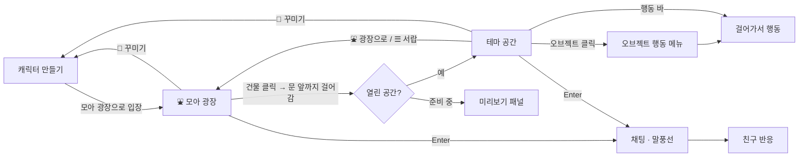

# MOA · 우리의 순간이 모이는 곳

친한 친구들끼리 미니미를 꾸미고, 테마 공간에 모여 채팅하고 함께 노는 프라이빗 3D 소셜 월드.

스택: React 19 + TypeScript · Three.js + React Three Fiber (+ drei) · Zustand · SCSS Modules · Vite

```bash
pnpm install
pnpm dev         # http://localhost:5173
pnpm build       # tsc(strict) + vite build
pnpm check       # 랠리 · 길찾기 · 카메라 · 번역 · 방 · 미니게임 규칙 + 서버 권한·경기 검증 검사 (node, PGlite)
```

### 배포 (Vercel)

**https://moa-moa-beta.vercel.app**

- `main`에 push → 자동으로 프로덕션 배포 (GitHub 연동, 1분 안팎)
- 다른 브랜치 push → 브랜치별 미리보기(Preview) URL 생성. 커밋 옆 Vercel 체크에서 링크 확인
- 빌드 설정은 Vercel이 자동 감지: `pnpm install` → `pnpm build` → `dist/`
- `vercel.json`: 해시가 붙은 `/assets/*`는 1년 캐시(immutable), `index.html`은 매번 새로 받음
- 로컬에서 직접 배포가 필요하면 `npx vercel --prod` (Vercel 로그인 필요)

### 계정 · 실시간 (Supabase)

`.env`에 Supabase 프로젝트를 넣으면 계정·저장·실시간 멀티플레이가 켜집니다. 비워 두면 서버 없이 돌아갑니다(localStorage 저장 + 더미 친구 2명 + 같은 브라우저 탭끼리 실시간).

1. [supabase.com](https://supabase.com)에서 프로젝트 생성
2. SQL Editor에서 `supabase/migrations/`의 SQL을 번호 순서대로 한 번씩 실행
   - `0001_profiles_realtime.sql`: 프로필 테이블 + RLS + 멤버 전용 realtime 채널
   - `0002_social.sql`: 설정(언어·자동 번역·귓속말 받기), 개인 공간, 그룹 방, 친구, 차단, 초대, 입장권, 내보내기, 귓속말 + 누가 어느 공간에 들어갈 수 있는지(서버 판단)
   - `0003_own_space.sql`: 갓 만든 계정도 첫 저장 전부터 자기 공간에 들어갈 수 있게
   - `0004_matches.sql`: 미니게임 경기 기록과 서버의 결과 검증, 기록 순위
   - `0005_space_games.sql`: 공간별 미니게임 5종(낚시·바리스타·스쿼트·기억력 카드·스타일링)의 결과 검증과 최고 점수
   - `0006_more_space_games.sql`: 공간별 두 번째 게임 5종(별자리·주문 기억·리듬·책 찾기·코디 투표)의 결과 검증
   - `0007_doubles.sql`: 테니스 2:2 복식 결과 검증(이긴 팀 두 명이 5점), 복식 최다 승리
3. Authentication → Sign In / Providers에서 **Allow anonymous sign-ins** 켜기 — 주소로 들어오면 그 브라우저에 계정이 저절로 생깁니다(이메일·로그인 화면 없음)
4. Authentication → Sign In / Providers → Email에서 **Confirm email** 끄기 — ⚙️ 설정에서 아이디·비밀번호를 만들면 로그아웃 후나 다른 기기에서도 같은 계정으로 로그인 (메일은 보내지 않음)
5. Realtime → Settings에서 **Allow public access**를 끄기 (비공개 채널만)
6. `.env.example`을 `.env`로 복사해 `VITE_SUPABASE_URL`, `VITE_SUPABASE_ANON_KEY` 입력, Vercel에도 같은 두 환경 변수 추가 후 재배포
7. (선택) 번역 키: [DeepL API Free](https://www.deepl.com/pro-api) 키를 Vercel 환경 변수 `DEEPL_API_KEY`(로컬은 `.env`)에 넣으면 DeepL로 번역. 없으면 무료 MyMemory

무엇이 저장/공유되나
- `profiles`: 닉네임·외형·마지막 공간·위치 + 설정(언어·자동 번역·귓속말 받기). 다시 들어오면 그 공간·자리에서 시작
- `spaces`(사람마다 하나: 이름·테마·공개 범위) · `rooms`(그룹 방: 이름·설명·테마·최대 인원·공개/비공개·비밀번호 해시) · `friends` · `blocks` · `invites`(만료 시간) · `passes`(초대 수락·방 비밀번호로 얻은 입장권) · `bans`(내보내기, 30분) · `direct_messages`(귓속말 원문 + 읽는 사람 언어 번역)
- 실시간 채널
  - `moa:world`: presence — 누가 접속했고 어느 방·공간에 있는지, 읽는 언어 (방 목록 인원, 광장 간판의 "안에 있는 친구")
  - `space:<주인 id>` / `room:<방 id>`: 그 장소의 움직임(최대 10회/초)·채팅·번역·내보내기. **들어갈 권한이 있는 사람만 채널에 들어올 수 있음** (`can_enter`, realtime 정책)
  - `user:<내 id>`: 나에게 온 귓속말·초대·친구 요청 (postgres changes, RLS로 나에게 온 것만)

**권한은 서버가 정합니다** (`0002_social.sql`, `pnpm check`로 검사)
- 개인 공간 공개 범위: 전체 공개(누구나) · 친구 공개(친구 + 초대받은 사람) · 초대 전용(초대받은 사람) · 비공개(주인만, 초대 불가)
- 그룹 방: 공개(누구나, 비밀번호가 있으면 맞혀야 입장권) · 비공개(목록에 없음, 초대로만). 비밀번호는 해시로만 저장되고 아무도 읽을 수 없음
- 초대: 공간은 주인만(비공개면 불가), 방은 그 방에 들어갈 수 있는 사람. 개인 초대는 1시간·한 번, 초대 링크는 24시간
- 내보내기: 주인만. 입장권이 사라지고 30분 동안 못 들어옴
- 귓속말: 보낸 사람과 받는 사람만 읽음. 받는 사람의 설정(모두/친구만/안 받기)과 차단을 서버가 확인. 원문은 고칠 수 없음
- 차단: 귓속말·초대·친구 요청·내 공간 입장이 막히고 친구 관계가 끊김

**번역** (`api/translate.ts`, Vercel Function — `pnpm dev`에선 Vite가 같은 함수를 서빙)
- 각자 ⚙️ 설정에서 **내 언어**(한국어·English·日本語)와 **자동 번역**을 고름. 쓰는 사람은 자기 언어로 그냥 씀
- 방 채팅: 원문을 먼저 보내고, 보낸 사람이 그 자리에 있는 다른 언어마다 **한 번씩만** 번역해 뒤따라 보냄 → 받는 사람 화면의 말풍선·채팅이 자기 언어로 바뀌고 원문은 아래에 작게
- 귓속말: 받는 사람이 자기 언어로 번역해 그 줄에 저장 (원문과 따로)
- 같은 언어·이모지는 번역하지 않음. 실패하면 원문 그대로. 같은 문장은 브라우저·서버에서 캐시
- 키는 서버에만 있고(`DEEPL_API_KEY`), 서버는 로그인한 MOA 멤버만 받음. 한 줄 500자, 한 사람 분당 40줄까지

### 폰에서 앱으로 쓰기 (PWA)

위 주소를 폰에서 열고 홈 화면에 추가하면 주소창 없는 앱으로 실행됩니다.

- **Android · Chrome / Edge(PC 포함)**: 캐릭터 만들기 화면이나 ☰ 서랍의 `📲 앱으로 설치` 버튼 (또는 브라우저 메뉴 → 앱 설치)
- **iPhone · iPad (Safari)**: 공유 버튼 → `홈 화면에 추가` (앱 안에도 안내가 보입니다)
- 한 번 열면 앱 화면·그림·폰트가 캐시돼서 바로 열리고, 오프라인에서도 실행됩니다 (`public/sw.js`)
- 아이콘(`public/icons/`)은 2D 시절 캐릭터 렌더러로 그린 PNG입니다

## 1. 화면 IA

```
MOA
├─ ① 캐릭터 만들기 (create)
│   ├─ 3D 미리보기 (드래그로 회전) + 모션 미리보기 (기본/걷기/뛰기/인사/춤/앉기)
│   ├─ 닉네임
│   ├─ 캐릭터 선택 (프리셋 4 + 랜덤)
│   └─ 커스터마이징 탭: 얼굴(피부·얼굴형·눈·코·입) · 헤어 · 옷 · 소품 (선택지마다 3D 썸네일)
└─ ② 월드 (world)
    ├─ ⛲ 모아 광장 (첫 입장 장소, 모두가 모이는 허브)
    │   ├─ 테마 건물 8채: 간판 · 테마 색 지붕 (아직 안 만든 테마는 회색 + 🔒 → 미리보기)
    │   └─ 분수 · 벤치 (앉기 · 인사 · 춤)
    ├─ 테마 공간 8곳: 🏕️ 캠핑장 · ⛪ 교회 · 🏊 수영장 · 🎾 테니스장 · 🏋️ 헬스장 · 📚 도서관 · 🛍️ 쇼핑몰 · 🍝 레스토랑
    ├─ 전체 화면: 3D 월드 (원근 쿼터뷰 카메라가 나를 부드럽게 따라감, 맵 밖으로는 안 나감)
    │   └─ 카메라: 확대·축소(최대 200%, 축소는 공간 전체가 화면에 들어올 때까지) (휠·핀치·＋/－ 버튼, 커서/두 손가락 위치 기준), 드래그로 화면 이동, ⟲ 기본 화면
    └─ 월드 위에 떠 있는 UI
        ├─ 상단 바: ☰ · 로고 · 공간 이름/접속 인원 · ⛲ 광장으로 · 내 캐릭터(꾸미기)
        ├─ ☰ 서랍: 공간 이동(광장 + 8개) · 친구 목록 · 추천 코디
        ├─ 패널(데스크톱 우측 / 폰 하단 시트): 응원 보드 · 집중 타이머 · 메뉴 · 랠리 미니게임 · 피팅룸 · 미리보기
        └─ 하단 독: 채팅 로그 · 감정 표현 · 입력창 + 행동 바
```

## 2. 사용자 플로우



## 3. 프로젝트 구조

```
src/
├─ data/                  ← 순수 데이터 (엔진·UI 무관)
│  ├─ character.ts        캐릭터 외형 모델, 옵션, 프리셋
│  ├─ anims.ts            애니메이션 = 포즈 프레임 목록
│  ├─ actions.ts          행동 = 라벨 + 재생할 애니메이션
│  └─ themes/             테마 하나당 파일 하나 (camping.ts, church.ts, …)
│     ├─ index.ts          등록부: PLAYABLE, THEMES(광장 건물 순서), THEME_CONFIGS
│     ├─ plaza.ts          테마 목록으로 광장을 만드는 makePlaza
│     └─ seats.ts          가구 뒤 좌석 헬퍼
├─ world/                 ← 3D 월드 (React Three Fiber)
│  ├─ space.ts            타일 ↔ 월드 좌표 (x = tx·T, z = ty·T), 이동 속도, 카메라 방향
│  ├─ sim.ts              월드 규칙: 걷기·길찾기·행동·문·더미 친구 AI (렌더러와 무관한 순수 TS)
│  ├─ path.ts             가구 발판(원) 피해 걷기: 이동 가능 판정 + 길찾기 (순수 함수)
│  ├─ kinds.ts            오브젝트 종류 + 물리 정보(막는 반경 foot, 불빛 light)
│  ├─ models.tsx          종류별 3D 모델 33종 (코드로 만든 스타일라이즈드 아트) + 좌석 의자
│  ├─ Avatar3D.tsx        3D 캐릭터 (외형 → 메시) + 포즈 → 관절 애니메이션 + 손에 드는 소품
│  ├─ Preview.tsx         꾸미기 화면의 회전 미리보기 + 모든 UI 아이콘용 3D 썸네일(숨은 캔버스 한 개 → 이미지 캐시)
│  ├─ Stage.tsx           조명·바닥(러그·길·코트 라인)·실내 벽/아치 창·야외 들판/나무/꽃·수영장 물·입자
│  ├─ World.tsx           캔버스 조립: 입력(방향키·탭), 오브젝트, 캐릭터, 라벨
│  ├─ CameraRig.tsx       따라가는 카메라 + 줌·팬 제스처(휠·드래그·핀치)와 버튼 명령
│  ├─ camera.ts           카메라 배치·바닥 지점 계산·이동 범위 (순수 함수, `pnpm check`)
│  ├─ labels.ts           닉네임·말풍선·간판을 3D 위치에 맞춰 띄우는 DOM 레이어
│  └─ toon.ts             카툰(셀) 셰이딩 재질 · 캔버스 텍스처
├─ hooks/                 ← 기능: React 쪽 로직 (구독·이펙트·핸들러)
│  ├─ useWorldSession.ts  게임 이벤트 → 스토어, 더미 친구, 공간 이동 목록
│  ├─ useActionBar.ts     표시할 행동 목록, 실행
│  ├─ useChat.ts          채팅 전송, Enter 포커스, 자동 스크롤
│  └─ useCheerBoard.ts    응원 메모 작성, 보드 닫기
├─ ui/                    ← 화면: 마크업 + className 만 (Panels.tsx = 월드 위 패널들)
├─ styles/                ← 스타일: 보이는 것 전부
│  ├─ global.scss         디자인 토큰 (CSS 변수) + 리셋
│  ├─ *.module.scss       화면별 스타일 (common = 버튼·칩·카드·로고)
│  ├─ World.module.scss   월드 위 라벨: 닉네임·말풍선·간판
│  └─ fonts.ts            픽셀 폰트 등록
├─ bridge.ts              React ↔ 3D 월드 타입 지정 채널
├─ net/                   ← 서버: supabase.ts(클라이언트·프로필), link.ts(실시간 링크: Supabase / 탭 간 BroadcastChannel),
│                            social.ts(친구·차단·귓속말·초대·공간·방: DB 호출 + 상태), rooms.ts, translate.ts
├─ ui/Social.tsx          ← 프로필 카드 · 귓속말 창 · 알림 · 친구 초대 · 설정 (로직은 hooks/useSocialPanels.ts)
├─ games/                 ← 미니게임: session.ts(공통 — 테이블·자리·준비·시작·게임 이벤트·결과·서버 보고·다시 하기·관전·이탈),
│                            controls.ts(키보드·터치), tennis.ts / swim.ts(규칙, 순수 TS), TennisGame / SwimGame.tsx(3D 장면·HUD),
│                            timed.ts(공간별 "N초 안에 점수" 게임 6종 규칙, 순수 TS) + TimedGame.tsx(공통 틀: 시계·실시간 점수·결과 교환) + Boards.tsx(각 게임 화면)
├─ ui/Minigame.tsx        ← 게임 목록(참가·관전) · 대기실 · 카운트다운 · 결과 (data/games.ts에 게임 등록)
├─ store.ts               Zustand (화면, 내 캐릭터, 채팅, 선택 상태, 접속 중인 친구, 마지막 장소)
└─ mock.ts                서버 없을 때의 더미 친구 2명 + 자동 채팅
```

**기능 / 스타일 분리 규칙**
- `ui/*.tsx`는 마크업과 `className`만 갖습니다. 상태 구독·이펙트·이벤트 로직은 `hooks/`로.
- 색·폰트·여백 같은 값은 `styles/`에만 둡니다. 데이터에서 오는 색(테마 하늘색, 색상 옵션)은 `style={{ '--stage-bg': … }}`처럼 CSS 변수로만 넘기고 실제 적용은 SCSS가 합니다.
- 월드 위 글자(닉네임·말풍선·간판)는 3D가 아니라 DOM이라 `World.module.scss`와 토큰으로 스타일합니다.
- 예외: 3D 모델과 캐릭터의 재질 색(`world/`)은 그림 자체라서 코드에 둡니다.

## 4. 핵심 설계

**3D 월드.** 테마 데이터는 타일 좌표(tx, ty)로 배치하고, 월드는 그 격자를 바닥에 눕힙니다(`x = tx·T`, `z = ty·T`). 카메라는 +x +z 대각선에서 원근 쿼터뷰로 내려다보고, 모든 모델은 기본으로 카메라 쪽을 봅니다. 그래서 2D 시절의 배치·좌석·벽 위치가 그대로 3D에 맞습니다. 규칙(`sim.ts`)은 렌더러를 모르고, 화면(`World.tsx`)은 매 프레임 그 상태를 읽어 그립니다.

**카툰 렌더링.** 모든 재질은 3단계 셀 셰이딩(`toon.ts`), 톤 매핑 없이(`flat`) 파스텔 색 그대로, 해와 하늘빛 + 부드러운 그림자. 밤 테마는 달빛 + 모닥불·랜턴 불빛.

**에셋 등급.** 지금 월드의 모든 캐릭터·오브젝트는 **코드로 만든 임시 아트**(툰 셰이딩 도형 조합, 한 가지 스타일로 통일)입니다. 최종 아트는 Blender에서 만든 GLB를 같은 로컬 좌표(바닥 y=0, 앞면 +z, 캐릭터는 같은 관절 이름)로 `models.tsx` / `Avatar3D.tsx`에 갈아 끼웁니다. 배치·충돌·좌석 같은 규칙은 데이터(`themes/`, `kinds.ts`)에 있어서 아트를 바꿔도 그대로입니다.

**배치 방향.** 야외에선 모든 물건이 카메라 쪽을 보고, 실내에선 뒷벽 옆의 물건(책장·카운터·러닝머신…)이 벽에 등을 붙입니다(`objectYaw`). 테이블·책상처럼 뒤에 앉는 가구는 좌석마다 의자가 자동으로 놓이고, 벤치·매트·선베드처럼 올라앉는 물건은 그 방향을 봅니다. 오브젝트 가까이 가면 그 자리에서 행동 버튼이 뜹니다(문은 `들어가기`).

**행동 ≠ 애니메이션.**

```
ActionId ('roast')  →  ActionDef { anim: 'campfire', durationMs? }   (actions.ts)
AnimKey ('campfire') →  { fps, frames: Pose[] }                       (anims.ts)
Pose                →  관절 각도 (프레임 사이 보간)                  (world/Avatar3D.tsx)
```

어디서 행동하는지는 테마가 정합니다. 오브젝트의 `actions`에 들어 있으면 그 오브젝트의 빈 `spots`로 걸어가서 실행하고, 아니면 제자리에서 실행합니다. 같은 행동을 주는 오브젝트가 여러 개면(교회 긴 의자 6개) 빈자리가 있는 가장 가까운 것으로 가고, 오브젝트를 클릭해서 고른 경우엔 그 오브젝트로 갑니다. `opens: 'board'` 같은 행동은 실행 중에 React 패널을 엽니다.

**테마 = 데이터.** `ThemeConfig { themeId, name, background, spawnPosition, availableActions, interactionObjects, recommendedOutfits, decorations }`. 월드 코드에는 테마별 분기가 없습니다. 광장도 테마 하나이고, 건물은 `enter: themeId`를 가진 오브젝트입니다(`THEMES` 목록에서 자동 생성). 새 테마를 `PLAYABLE`에 넣으면 광장 건물의 🔒이 자동으로 풀립니다. 개발 모드에서는 `checkThemes()`가 스폰/스팟 위치와 행동 참조를 검사합니다.

**React ↔ 3D 월드는 `bridge.ts`로만 통신합니다.**

| 방향 | 이벤트 | 내용 |
|---|---|---|
| React → 월드 | `act` | 내 캐릭터 행동 실행 (`objectId`로 대상 지정 가능) |
| | `stop` | 행동 중지 (패널 닫기) |
| | `chat` | 말풍선 표시 |
| 월드 → React | `objectClick` | 오브젝트 행동 메뉴 열기 |
| | `actionChange` | 행동 바 활성 표시 |
| | `portal` | 건물 문 앞 도착 → 입장 또는 미리보기 |

## 5. 새 테마 추가하기

1. `anims.ts`에 필요한 애니메이션 추가 (예: `swim`), 새 포즈 값이면 `world/Avatar3D.tsx`의 `targets()`에 관절 각도 추가
2. `actions.ts`에 행동 추가
3. `world/kinds.ts`에 종류 추가 (`foot` = 막는 바닥 반경, 앉거나 올라서는 물건은 생략) + `world/models.tsx`에 3D 모델
4. `data/themes/<테마>.ts`에 `ThemeConfig` 작성 → `index.ts`의 `PLAYABLE`과 `THEMES`에 넣으면 끝 (광장 건물·사이드바가 자동으로 열림)
   - 패널이 필요하면 행동에 `opens`를 달고 `hooks/`에 로직, `ui/Panels.tsx`에 마크업, `styles/Panels.module.scss`에 스타일
   - 배경 옵션: 야외는 `night`(별·달) · `hills` · `flowers`, 실내는 `walls`(스테인드글라스 창) · `rugs`(바닥 러너), 공통으로 `motes`(반딧불·먼지 입자)
5. (선택) `mock.ts`의 `AMBIENT`에 그 공간에서 친구들이 할 말 추가
6. `pnpm dev`로 열면 `checkThemes()`가 시작 위치·행동 자리가 맵 안, 가구 발판 밖인지 검사합니다

## 6. 로드맵

- [x] **MVP**: 캐릭터 꾸미기, 캠핑장, 방향키 이동, 모닥불·앉기·요리 모션, 더미 친구 2명, 로컬 채팅, 테마 선택(7개 미리보기)
- [x] **교회**: 첫 실내 테마. 기도·긴 의자 앉기·촛불 켜기 모션, 응원 보드(메모 저장, 친구 반응)
- [x] **모아 광장**: 첫 입장 허브. 테마 건물 클릭 → 문까지 걸어가 입장, 준비 중 건물은 미리보기 (테마 선택 화면 대체)
- [x] **도서관**: 책 읽기·공부하기 모션, 테이블 뒤에 앉는 좌석, 집중 타이머 패널(5/15/25분)
- [x] **레스토랑**: 식사·음료·대화 모션, 테이블 4개(뒤쪽 좌석), 주문 카운터 + 메뉴 패널(주문하면 잠시 뒤 서빙 알림)
- [x] **헬스장**: 덤벨·러닝·스트레칭(몸 기울이기)·스쿼트 모션, 러닝머신 2대·덤벨 랙·요가 매트, 거울 벽
- [x] **수영장**: 물속 포즈(어깨까지 잠김), 수영·튜브·물장구 모션, 선베드·파라솔·사다리, 낮 하늘
- [x] **테니스장**: 서브·스윙·랠리 모션(라켓), 대각선 네트, 랠리 미니게임(타이밍, 갈수록 빨라짐 · `pnpm check`로 규칙 검사)
- [x] **쇼핑몰**: 옷걸이·피팅룸·전신 거울, 런웨이 러그, 옷 구경·try_on(빙글)·거울 포즈 모션, 피팅룸 패널(코디 6종을 내 캐릭터로 미리보기 → 바로 갈아입기, 코디 공유, 직접 꾸미기)
- [x] **앱(PWA)**: 홈 화면 설치(매니페스트·아이콘), 설치 버튼 / iOS 안내, 서비스 워커로 즉시 실행·오프라인 실행
- [x] **3D 월드 기반**: Phaser 2D → React Three Fiber. 원근 쿼터뷰 추적 카메라(경계 제한), 카툰 셰이딩·그림자, 3D 캐릭터(포즈 데이터 → 관절 보간), 광장 3D 모델(건물·분수·벤치·나무·덤불·화분·바위), 실내 벽·스테인드글라스 창, 야외 들판·나무·꽃, 탭/방향키 이동·충돌·길찾기 유지
- [x] **테마 3D 모델**: 8개 테마 오브젝트 전부(텐트·모닥불·그릴·랜턴·제단·촛대·응원 보드·책장·테이블·책상·식탁·카운터·메뉴판·러닝머신·덤벨 랙·매트·사다리·선베드·파라솔·튜브·네트·공 바구니·옷걸이·피팅룸·거울), 좌석 의자 자동 배치, 손 소품(마시멜로·뒤집개·촛불·펜·책·포크·컵·덤벨·라켓·공·튜브·물보라·반짝이), 근접 상호작용 버튼, 출렁이는 수영장 물, 실내 가구 벽 정렬
- [x] **3D 캐릭터 꾸미기**: 회전 미리보기(드래그·자동 회전), 얼굴형·코 추가(저장된 캐릭터는 자동 보정), 걷기·뛰기·앉기·인사·춤 미리보기, 상단 바·친구 목록·프리셋·선택지·피팅룸 아이콘을 3D 썸네일로, 2D 픽셀 렌더러 제거
- [x] **계정·실시간 (Supabase)**: 익명 계정(주소로 들어오면 브라우저마다 자동 생성, 이메일 없음), 프로필(외형·닉네임·마지막 공간·위치) 저장과 재접속 복원, presence로 접속자·위치한 공간, broadcast로 움직임·행동·채팅 실시간 동기화, 광장 간판에 안에 있는 친구 표시, RLS + 멤버 전용 비공개 채널. 서버 없이도 탭끼리 실시간 확인 가능
- [x] **넓은 공간**: 모든 공간 16×16칸. 야외(광장·캠핑장·수영장·테니스장)는 네모에 갇히지 않고 둘레 풀밭(둥근 영역, 나무·덤불·바위)까지 걸어 나갈 수 있고 그 너머는 숲. 실내는 가구·소품을 더 채움(사용 가능한 테이블·랙·매트·의자 등)
- [x] **방**: 모두 자기 공간에서 시작 → ☰ 친구 목록에서 초대 → 수락하면 초대한 사람의 방·공간으로 모임. 🚪 방 목록에서 방 만들기·입장(한 방 최대 10명, 동시에 들어와 넘치면 늦게 온 사람이 자기 공간으로). 같은 방 사람끼리만 보이고 채팅이 오감. 방은 접속 상태(presence)로만 존재해 DB 테이블 없음
- [x] **채팅 번역**: 처음엔 보내는 사람이 말풍선 언어를 골랐고, 지금은 **읽는 사람 기준** — 각자 ⚙️에서 고른 내 언어로 방 채팅·말풍선·귓속말이 자동 번역(원문은 아래에), 키는 서버(`/api/translate`)에만
- [x] **카메라 줌·팬**: 마우스 휠(커서 기준)·핀치(두 손가락 중앙 기준)로 확대·축소(최대 200%, 끝까지 줄이면 공간 전체가 화면 가운데에), 드래그로 이동(맵 밖은 범위 제한, 줌에 따라 넓어지고 좁아짐), ＋/－/⟲ 버튼과 현재 배율 표시, 걸으면 카메라가 다시 나를 따라옴, 탭은 손을 뗄 때만(드래그·핀치는 탭이 아님), 페이지 자체 확대 차단
- [x] **소셜**: 캐릭터(이름표)를 누르면 프로필 카드 — 💌 귓속말 · 👫 친구 추가 · 🏠 공간 방문 · 🚪 여기로 초대 · 👢 내보내기 · 🚫 차단. 귓속말은 떠 있는 창(접기·닫기, 걸으면서도 보임)과 채팅창의 💬/💌 모드, 저장돼서 다시 들어와도 그대로, 안 읽은 수 배지. 🔔 알림(초대·친구 요청), ⚙️ 설정(내 언어·자동 번역·귓속말 받기·내 공간 이름/테마/공개 범위·차단 목록·아이디/로그아웃). 그룹 방은 설명·테마·최대 인원(2~10)·공개/비공개·비밀번호, 방장은 설정 변경·내보내기·방 닫기. 초대 링크(24시간). 같은 계정을 다른 창에서 열면 이전 창은 비켜 줌, 연결이 끊기면 상단에 "다시 연결 중". 권한은 전부 서버(RLS·realtime 정책)가 확인
- [x] **미니게임 시스템**: 테마 오브젝트에서 게임 테이블을 열면(테니스 코트 → 🏆 1:1 경기 신청, 수영장 → 🏁 수영 레이스) 같은 공간 사람들 화면에 목록이 떠서 참가·관전. 대기실(자리·준비 상태·친구 초대·서버 기록 순위) → 3·2·1 → 경기 → 결과(순위, 서버 확인 상태) → 다시 하기 / 나가기(원래 공간). 혼자면 컴퓨터와. 키보드(← → Space)와 터치 버튼. 경기 중에도 채팅·귓속말 가능, 뒤의 월드는 멈춰 성능 확보. 결과는 서버가 검증(참가 자격, 서버 시계로 걸린 시간, 점수 범위, 참가자 보고 일치)한 것만 기록. 중도 이탈은 남은 사람 승/기권 처리
  - **테니스 1:1** (2:2 복식은 아래): 3D 코트에서 실제 캐릭터로. 좌우 이동 + 타이밍 스윙(도달 거리·빠름·늦음 판정, 방향키로 코스 조절), 랠리가 길수록 빨라짐, 서브 교대, 5점 선승, 실시간 점수판. 공을 받는 쪽이 자기 화면 기준으로 판정해 지연에 공정
  - **수영 레이스 25m**: 최대 4명(혼자면 컴퓨터 2명). 왼팔·오른팔 번갈아, 박자 맞추면 빠르고 연타·같은 팔은 느림, 물보라, 실시간 순위·기록. 기기 화면 속도와 무관하게 같은 물리(1/60초 고정 단계)
- [x] **점프**: 모든 공간(교회 제외)에서 ⤴️ 점프 — 몸 전체가 뜨고 그림자는 바닥에
- [x] **그래픽 리뉴얼(코드 아트)**: 셀 셰이딩 → 부드러운 음영(말랑한 비닐 장난감 느낌), 그라데이션 하늘 돔 + 지평선 안개, 부드러운 그림자, 얼굴을 비추는 정면 보조광. 광장은 잔디밭 + 돌길(바닥 텍스처의 `stone` 러그) + 둥근 활엽수·가로등의 마을로, 잔디는 결이 보이게. 테니스장은 파란 하드코트 + 민트 에이프런 + 관람 벤치, 수영장 물은 빛 일렁임(전에는 물 표면이 아래를 향해 안 보이던 버그도 수정)
  - **테니스 경기 장면**: 펜스·관중석·점수판(이름·점수)·공원 나무, 공 궤적과 떨어질 자리 표시
  - **수영 경기 장면**: 타일 수조(벽·바닥·레인 표시)와 바닥의 빛 일렁임, 비치는 물, 레인 로프(벽 근처 빨강), 출발대, 5m 깃발, 선베드·파라솔. 캐릭터가 엎드려 자유형(속도만큼 팔을 돌리고 발차기), 스트로크마다 물방울
  - **표정**: 채팅에 ❤️ → 하트 눈, 😮 → 동그란 눈, 😆·ㅋㅋ → 웃는 눈 + 벌린 입, ✨·👋 → 웃는 눈(몇 초간, 같은 공간 모두에게)
  - **의상 추가**: 원피스, 밀짚모자, 꽃 핀
- [x] **자연스러운 경기 신청**: 게임을 강제로 시작하지 않고, 대화하다가 신청 → 수락으로. 코트에서 🏆 1:1 경기 신청을 누르면 대기실에 같은 방 사람이 떠서 한 명씩 신청, 프로필 카드에서도 🎾 테니스 신청 · 🏊 수영 신청. 받는 사람은 방 안 어느 공간에 있든 알림(수락 · 다음에) → 수락하면 그 공간으로 가서 자리에 앉음, 다음에면 신청한 사람에게 안내. 답이 없으면 30초 뒤 자동으로 다음에
- [x] **공간마다 미니게임**: 같은 시스템(테이블·참가·관전·신청·서버 검증)에 "N초 안에 점수" 공통 틀을 얹어 6종. 게임 카드가 월드 위에 뜨고 월드는 계속 움직임(카메라가 내 캐릭터를 카드 위로 올려 줌). 모두 같은 시드로 같은 문제를 받고, 점수는 실시간으로 서로·관전자에게 보이며, 끝나면 각자의 최종 점수를 주고받아 같은 결과를 서버에 보고. 서버는 라운드가 끝난 뒤인지, 정수 점수가 게임의 최댓값 이하인지 확인(`0005`)
  - 🏕️ **호숫가 낚시**(캠핑장에 연못과 낚시터 추가): 찌가 쏙 들어가면 낚아채기, 큰 물고기일수록 점수↑·기회↓, 헛챔질하면 다음 입질이 도망 — 40초
  - 🍝 **바리스타 챌린지**(카운터 · 커피 바): 주문에 맞는 재료를 컵에 담아 내기(숫자키 1–7), 메뉴판의 레시피 8종 — 45초
  - 🏋️ **스쿼트 타이밍**(요가 매트): 게이지가 초록 칸에 올 때 스쿼트, 한가운데 2점·근처 1점·빗나가면 휘청, 할수록 빨라짐 — 40초
  - 📚 **기억력 카드**(열람 테이블): 8쌍 짝 맞추기, 다 찾으면 새 판 — 60초
  - 🛍️ **스타일링 챌린지**(전신 거울): 손님 주문대로 모자·옷·소품 고르기, 내 캐릭터 미리보기에 바로 입혀짐 — 45초
  - ⛪ **함께 호흡하기**(긴 의자): 원이 커질 때 누르고 작아질 때 떼기, 함께한 친구의 호흡도 작은 원으로. 종교 공간이라 점수·순위·서버 기록 없음 — 64초
  - 프로필 카드의 경기 신청 버튼은 지금 공간의 게임만(광장에선 전부)
- [x] **공간별 두 번째 게임** (같은 틀, 보드끼리 주고받는 통로 추가: 내 모습·투표·조각 돌리기 등)
  - 🏕️ **별자리 잇기**(모닥불): 밤하늘의 별을 1번부터 차례로 — 북두칠성·카시오페이아·오리온 등 6개, 45초
  - 🍝 **주문 기억하기**(카운터): 하나씩 보여 주는 주문을 순서대로, 맞히면 길어지고 틀리면 짧아짐, 50초
  - 🏋️ **리듬 운동**(요가 매트): 세 줄로 떨어지는 음표를 선에서 J·K·L(터치), 아무 때나 누르면 감점, 40초 (방향키는 뒤 월드에서 캐릭터가 움직여서 안 씀)
  - 📚 **책 찾기**(스터디 데스크): 색·모양이 같은 책을 책장 24권 중에서 — 글자가 없어 어느 나라 사람이든, 45초
  - 🛍️ **코디 투표**(피팅룸): 주제에 맞게 28초 동안 입고, 모두의 코디(그림 카드)를 보고 나 말고 한 명에게 투표, 받은 표가 점수. 혼자면 컴퓨터가 주제에 맞는 정도로 투표
  - ⛪ **스테인드글라스**(긴 의자): 3×3 조각을 돌려 장미창 완성, 함께하는 사람 모두가 같은 창을 같이 맞춤(누가 돌려도 모두에게). 점수 없음, 결과는 "함께 완성한 창 n장"
- [x] **테니스 2:2 복식**: 자리 0·2 대 1·3, 각자 코트 절반(왼쪽·오른쪽)을 맡고 공이 떨어지는 쪽 사람이 받음(그래서 받을 사람은 늘 한 명), 서브는 팀끼리 번갈아·팀 안에서도 번갈아. 친구가 모자라면 빈자리는 컴퓨터(호스트가 대신 움직이고 모두에게 전달) — 혼자면 컴퓨터 3명, 둘이면 각자 컴퓨터 짝꿍. 대기실에 🔴/🔵 팀 표시, 점수판은 팀 이름(나·짝꿍). 컴퓨터 선수는 이제 게임마다 서로 다른 옷
- [ ] 서브 정확도 챌린지 · 수영 장애물·보물찾기·다이빙 · 테마별 일반 활동 확장(코트 예약, 텐트 설치, 단체 사진 등)
- [ ] 공간별 게임 12종의 화면은 2D 카드(월드 위)이고, 테니스·수영처럼 전용 3D 경기 장면은 아님
- [ ] 최종 아트: Blender GLB 캐릭터·오브젝트로 교체 (`models.tsx`, `Avatar3D.tsx` 같은 로컬 좌표) — 지금 그래픽은 코드로 만든 모델에 조명·재질·텍스처를 다듬은 것
- [x] **실내 공간 꾸미기**(레스토랑·헬스장·도서관·쇼핑몰·교회): 넓어진 방(16×16)이 텅 비어 보이던 것을 — 바닥 타일을 반 칸 크기로, 도서관은 나무 마루, 벽 아래쪽 징두리 판과 몰딩, 벽 액자. 새 소품 15종(소파·안락의자·스탠드 조명·케이크 진열장·액자·실내 자전거·벤치프레스·짐볼·정수기·지구본·북카트·드레스 폼·진열 테이블·기둥·꽃 스탠드). 카페 소파 라운지와 쇼핑몰 쉼터 소파, 도서관 안락의자는 실제로 앉을 수 있음(카페 소파에선 음료·대화도). 들어오자마자 보이는 입구 쪽에 메뉴 칠판·꽃·진열 테이블·북카트 등
- [x] **관전자가 관중석에**: 관전을 누르면 호스트에게 알려지고(나가면 빠짐, 공간을 떠나도 빠짐) 테이블 정보로 모두에게 전달 — 테니스는 관중석(앞줄부터, 최대 36명), 수영은 선베드와 수영장 가장자리에 그 사람 캐릭터가 앉거나 서서 보이고, 득점·골인 때 활짝 웃음. 대기실에 관전 인원 표시
- [x] **전체 화면 + 모바일**: 월드가 화면을 꽉 채우고 UI는 그 위에 떠 있음. 폰(세로·가로)에선 한 열 레이아웃, 카메라가 나를 따라감, 고해상도(DPR) 렌더링
- [x] **클릭·탭 이동**: 바닥을 누르면 그 자리로 걸어감(맵 밖은 가장자리로), 누른 자리에 링 표시, 터치하면 채팅 키보드 닫힘
- [x] **오브젝트 충돌**: 가구·나무가 바닥을 막음(방향키는 가장자리를 미끄러짐), 클릭·행동·친구 이동은 길찾기로 돌아감, 막힌 곳을 누르면 가장 가까운 곳까지
- [x] **뒷모습**: 화면 위쪽으로 걸으면 뒤통수·뒷머리(긴 머리는 등까지)·후드가 보이고, 멈춰도 유지, 행동을 시작하면 다시 앞모습
